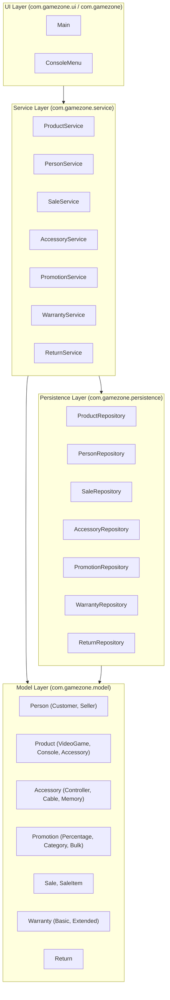

# GameZone Unicesar

GameZone Unicesar is a robust, console-based enterprise solution designed to manage inventory, customer and seller data, sales transactions, promotional campaigns, warranties, returns, and financial balances for a video game store. Developed as part of the Programación de Computadores III (SS462) curriculum, Ingeniería de Sistemas, Universidad Popular del Cesar.

---

## Table of Contents
- [Features](#features)
- [System Architecture](#system-architecture)
- [Technologies Used](#technologies-used)
- [Requirements](#requirements)
- [Build and Run](#build-and-run)
- [Console Menu Overview](#console-menu-overview)
- [Persistence & Data Storage](#persistence--data-storage)
- [Repository Structure](#repository-structure)
- [Design Documentation](#design-documentation)
- [Team Members & Authors](#team-members--authors)

---

## Features

- **Product & Inventory Management:**
  - Register and manage traditional products: **Video Games** (platform, genre, age rating) and **Consoles** (brand, model, generation).
  - Search by identifier, update price/stock, delete records, and query specific subsets (all products, only video games, or only consoles).

- **Accessory Management:**
  - Register specialized accessories extending the core product hierarchy:
    - **Controllers:** Connection type (wired / wireless).
    - **Cables:** Length (meters) and connector type (HDMI, USB-C, Ethernet, DisplayPort).
    - **Memories:** Capacity (GB) and storage type (SD, microSD, NVMe, DDR4).
  - Query accessories by category or verify compatibility against specific console models.

- **Person Management:**
  - Manage store actors through an abstract `Person` hierarchy:
    - **Customers:** ID, full name, phone number, email validation, and purchase history.
    - **Sellers:** ID, full name, phone number, employee code, and work shift.

- **Sales Transactions & Unified Registration:**
  - Register heterogeneous sales combining video games, consoles, and accessories in a single order.
  - Multi-tier validation: customer and seller existence, inventory stock availability, and non-empty carts.
  - Automatic calculation of subtotal, best applicable promotional discount, extended warranty charges, and final total.
  - Inventory deduction upon transaction completion and formatted receipt generation.

- **Promotions & Discount Engine:**
  - Dynamic campaign rules:
    - **Percentage Discount:** Global percentage applied across the entire sale.
    - **Category Discount:** Targeted percentage off specific item categories (`VIDEOGAME`, `CONSOLE`, and `ACCESSORY`).
    - **Bulk Purchase Discount:** Tiered volume discount triggered when cart item volume meets a minimum threshold.
  - **Best Discount Selection (`findBestPromotionFor`):** Compares all active promotions to automatically grant the customer the highest savings without manual intervention or stacking conflicts.

- **Warranty Management:**
  - **Basic Warranty:** Automatically granted free of charge (6 months duration) on all console sales.
  - **Extended Warranty:** Optional 12-month coverage against accidental damage (10% additional cost over the console price, integrated into the sale total).
  - Inspection tools: Query warranty certificate by Sale ID and Product ID, list all warranties, list active warranties, and detect warranties expiring within a user-defined number of days.

- **Returns Management & Financial Reporting:**
  - Register product returns enforcing strict business rules: 30-day return window from sale date and sale ownership verification.
  - Partial returns supported: customers can return a subset of items while keeping the rest.
  - **Inventory Restoration:** Automatically restores stock for traditional products (`ProductService`) and accessories (`AccessoryService`).
  - **Proportional Refund:** Discounter-aware refunds based on the original promotion ratio (`price * (1 - discount / subtotal)`), preventing refunds greater than what was actually paid.
  - **Warranty Invalidation:** Cancels associated warranties upon console returns and refunds extended warranty fees.
  - **Monthly Financial Balance:** Computes total monthly sales, total monthly refunds, and net store revenue (`Sales - Returns`).

---

## System Architecture

The project adheres to a strict **4-layer architectural pattern** with single-direction dependency flow:  
`UI Layer` ➔ `Service Layer` ➔ `Persistence Layer` / `Model Layer`.



### Architectural Guarantees
- **Model:** Independent domain entities with zero external dependencies.
- **Persistence:** Dedicated repositories handling CSV file I/O and object serialization/deserialization.
- **Service:** Encapsulates business logic, orchestrates cross-module workflows, and manages validation rules.
- **UI:** Interactive console menu handling user input/output in Spanish, defensive input retry loops, and delegating all operations to the service layer.

---

## Technologies Used

* **Language:** Java (JDK 26)
* **Build Tool:** Apache Maven 3.9+
* **IDE:** IntelliJ IDEA / NetBeans / VS Code
* **Version Control:** Git & GitHub (Git Flow branching strategy)
* **Design & Modeling:** Mermaid diagrams and Markdown specifications

---

## Requirements

- **Java Development Kit (JDK):** Version 26 (or JDK 21+ compatible)
- **Apache Maven:** Version 3.9 or higher

---

## Build and Run

### 1. Compile the Project
```bash
mvn clean compile
```

### 2. Execute the Application
```bash
mvn exec:java "-Dexec.mainClass=com.gamezone.Main"
```

---

## Console Menu Overview

When launched, the system presents an interactive menu in Spanish:

```text
===== GameZone Unicesar =====
1. Gestión de productos
2. Gestión de personas
3. Gestión de ventas
4. Gestión de accesorios
5. Gestión de promociones
6. Gestión de devoluciones
0. Salir
```

- **Gestión de productos:** Register and filter video games and consoles, view inventory, modify or remove records.
- **Gestión de personas:** Register and list customers and sellers with email and code validation.
- **Gestión de ventas:** Multi-item checkout (products + accessories), extended warranty prompts for consoles, receipt generation, and sales history.
- **Gestión de accesorios:** Register controllers, cables, and memory modules; filter by type or console compatibility.
- **Gestión de promociones:** Register percentage, category, and bulk promotions; view active promotions.
- **Gestión de devoluciones:** Process returns within 30 days, view receipts with proportional refunds, and generate monthly financial balances.

---

## Persistence & Data Storage

All data is stored in human-readable CSV format under the `data/` directory. Files are loaded on application start and updated automatically on each transaction:

- `data/products.csv`: Video games and consoles inventory.
- `data/accessories.csv`: Controllers, cables, and memory cards with specifications.
- `data/customers.csv`: Customer contact and identification records.
- `data/sellers.csv`: Seller records, employee codes, and shifts.
- `data/promotions.csv`: Configured promotional campaigns and validity windows.
- `data/sales.csv`: Historical sales transactions (`id,date,customerId,sellerId,items,extendedWarrantyCost`).
- `data/warranties.csv`: Basic and extended warranty records (`type,id,productId,saleId,startDate`).
- `data/returns.csv`: Registered returns and refund records (`id,date,reason,saleId`).

---

## Repository Structure

```
GameZoneUnicesar/
├── README.md
├── TEAM.md
├── pom.xml
├── .gitignore
├── src/
│   └── main/
│       └── java/
│           └── com/
│               └── gamezone/
│                   ├── model/
│                   │   ├── Accessory.java
│                   │   ├── BasicWarranty.java
│                   │   ├── BulkPurchaseDiscount.java
│                   │   ├── Cable.java
│                   │   ├── CategoryDiscount.java
│                   │   ├── Console.java
│                   │   ├── Controller.java
│                   │   ├── Customer.java
│                   │   ├── ExtendedWarranty.java
│                   │   ├── Memory.java
│                   │   ├── PercentageDiscount.java
│                   │   ├── Person.java
│                   │   ├── Product.java
│                   │   ├── Promotion.java
│                   │   ├── Return.java
│                   │   ├── Sale.java
│                   │   ├── SaleItem.java
│                   │   ├── Seller.java
│                   │   ├── VideoGame.java
│                   │   └── Warranty.java
│                   ├── persistence/
│                   │   ├── AccessoryRepository.java
│                   │   ├── PersonRepository.java
│                   │   ├── ProductRepository.java
│                   │   ├── PromotionRepository.java
│                   │   ├── ReturnRepository.java
│                   │   ├── SaleRepository.java
│                   │   └── WarrantyRepository.java
│                   ├── service/
│                   │   ├── AccessoryService.java
│                   │   ├── PersonService.java
│                   │   ├── ProductService.java
│                   │   ├── PromotionService.java
│                   │   ├── ReturnService.java
│                   │   ├── SaleService.java
│                   │   └── WarrantyService.java
│                   ├── ui/
│                   │   └── ConsoleMenu.java
│                   └── Main.java
├── data/
│   ├── accessories.csv
│   ├── customers.csv
│   ├── products.csv
│   ├── promotions.csv
│   ├── returns.csv
│   ├── sales.csv
│   ├── sellers.csv
│   └── warranties.csv
└── docs/
    ├── analysis.md
    ├── accessory-analysis.md
    ├── promotion-analysis.md
    ├── return-analysis.md
    ├── integration-analysis.md
    ├── hierarchy-diagram.md
    ├── class-diagram.md
    ├── accessory-class-diagram.md
    ├── promotion-class-diagram.md
    ├── return-class-diagram.md
    ├── warranty-class-diagram.md
    ├── layers-diagram.md
    └── ai-usage/
        ├── leader-ai-log.md
        ├── developer1-ai-log.md
        └── developer2-ai-log.md
```

---

## Design Documentation

- [General Analysis](docs/analysis.md)
- [Accessory Module Analysis](docs/accessory-analysis.md)
- [Promotion Module Analysis](docs/promotion-analysis.md)
- [Return Module Analysis](docs/return-analysis.md)
- [Hierarchy Diagram](docs/hierarchy-diagram.md)
- [Full Class Diagram](docs/class-diagram.md)
- [Accessory Class Diagram](docs/accessory-class-diagram.md)
- [Promotion Class Diagram](docs/promotion-class-diagram.md)
- [Return Class Diagram](docs/return-class-diagram.md)
- [Warranty Class Diagram](docs/warranty-class-diagram.md)
- [Layers Diagram](docs/layers-diagram.md)

### AI Usage Logs
- [Technical Lead Consultation Log](docs/ai-usage/leader-ai-log.md)
- [Developer 1 Consultation Log](docs/ai-usage/developer1-ai-log.md)
- [Developer 2 Consultation Log](docs/ai-usage/developer2-ai-log.md)

---

## Team Members & Authors

| Name | Student Code | Role | GitHub Profile |
|---|---|---|---|
| **Sergio Guerrero** | 1065600217 | Technical Lead (Sale, UI, Main, Integrations) | [@sergioaguerrero](https://github.com/sergioaguerrero) |
| **Isaac Mattos** | 1042854691 | Developer 1 (Product Module: Video Games, Consoles) | [@IDMattos](https://github.com/IDMattos) |
| **Jhonatan Galindo** | 1066283456 | Developer 2 (Person & Accessory Modules) | [@Jhonatandgalindo](https://github.com/Jhonatandgalindo) |

See [TEAM.md](TEAM.md) for detailed role distributions and committed sprint activities.
