# Class Diagrams — Before and After GRASP Refactoring

**Project:** GameZone Unicesar  
**Authors:** Sergio Guerrero (Technical Lead), Isaac Mattos (Developer 1), Jhonatan Galindo (Developer 2)

---

## 1. Class Diagram — Before Refactoring (Phase 2 Start)

This diagram represents the classes involved in the consolidated audit violations at the start of Phase 2, highlighting the design problems with notes linked to violation identifiers (`V-XX`).

```mermaid
classDiagram
    direction TB

    class Sale {
        -String id
        -LocalDate date
        -Customer customer
        -Seller seller
        -List~SaleItem~ items
        -String appliedPromotionName
        -double discountAmount
        -double extendedWarrantyCost
        +addItem(SaleItem item)
        +calculateTotal() double
        +calculateSubtotal() double
        +calculateFinalTotal() double
        +generateReceipt() String
        +canBeReturned() boolean
    }
    note for Sale "V-01: Missing getDiscountRatio(), forcing Return to calculate it\nV-02: Missing getTotalQuantity(), forcing BulkPurchaseDiscount to iterate items\nV-06: canBeReturned() hardcodes 30-day window and LocalDate.now()"

    class Return {
        -String returnId
        -Sale originalSale
        -List~SaleItem~ returnedItems
        -double refundAmount
        +calculateItemRefund(SaleItem, double) double
        +calculateRefundAmount(double) double
        +generateReturnReceipt() String
    }
    note for Return "V-01: Breaches Information Expert by calculating originalSale discount ratio"

    class BulkPurchaseDiscount {
        -int minUnits
        -double percentage
        +calculateDiscount(Sale sale) double
    }
    note for BulkPurchaseDiscount "V-02: Breaches Information Expert by summing item quantities from sale\nV-05: Redundant percentage range validation"

    class CategoryDiscount {
        -String targetCategory
        -double percentage
        +calculateDiscount(Sale sale) double
        -belongsToTargetCategory(Product) boolean
    }
    note for CategoryDiscount "V-03: Breaches Polymorphism using instanceof VideoGame/Console/Accessory\nV-05: Redundant percentage range validation"

    class PercentageDiscount {
        -double percentage
        +calculateDiscount(Sale sale) double
    }
    note for PercentageDiscount "V-05: Redundant percentage range validation"

    class Product {
        <<abstract>>
        -String productId
        -String title
        -double price
        -int stock
        +getFullDescription()* String
        +hasEnoughStock(int) boolean
        +decreaseStock(int)
        +increaseStock(int)
    }

    class VideoGame {
        -String platform
        -String genre
        +getFullDescription() String
    }

    class Console {
        -String manufacturer
        -String storageCapacity
        +getFullDescription() String
    }

    class Accessory {
        <<abstract>>
        -String accessoryType
        +getAccessoryType()* String
    }

    Product <|-- VideoGame
    Product <|-- Console
    Product <|-- Accessory

    class Customer {
        -List~Sale~ purchaseHistory
        +getPurchaseHistory() List~Sale~
        +addPurchaseHistory(Sale)
    }
    note for Customer "V-08: Unused bidirectional coupling to Sale"

    class PersonRepository {
        +saveCustomers(List~Customer~)
        +loadCustomer() List~Customer~
        +deleteSeller(List~Seller~, String)
        +deleteCustomer(List~Customer~, String)
    }
    note for PersonRepository "V-09: Unused deletion operations in persistence\nFD-08: Console printing in persistence"

    class ProductRepository {
        +saveAll(List~Product~)
        +loadAll() List~Product~
        -toCsvLine(Product) String
        -fromCsvLine(String) Product
    }
    note for ProductRepository "V-04: Procedural instanceof and string type branching for CSV serialization"

    class AccessoryRepository {
        +saveAll(List~Accessory~)
        +loadAll() List~Accessory~
        -toCsvLine(Accessory) String
        -fromCsvLine(String) Accessory
    }
    note for AccessoryRepository "V-11: Procedural instanceof for accessory CSV serialization"

    class PromotionRepository {
        +saveAll(List~Promotion~)
        +loadAll() List~Promotion~
        -toCsvLine(Promotion) String
        -fromCsvLine(String) Promotion
    }
    note for PromotionRepository "V-12: Procedural instanceof for promotion CSV serialization"

    class WarrantyRepository {
        +saveAll(List~Warranty~)
        +loadAll(List~Sale~, List~Product~) List~Warranty~
        -fromCsvLine(String, List~Sale~, List~Product~) Warranty
    }
    note for WarrantyRepository "V-15: Repository resolves domain Sale and Product references"

    class WarrantyService {
        -List~Warranty~ warranties
        +assignBasicWarranty(Product, Sale, LocalDate) BasicWarranty
        +assignExtendedWarranty(Product, Sale, LocalDate) ExtendedWarranty
        +cancelWarranties(String) double
        +getWarranties() List~Warranty~
        +setWarranties(List~Warranty~)
    }
    note for WarrantyService "V-14: Redundant instanceof ExtendedWarranty check in cancelWarranties\nV-17: getWarranties/setWarranties expose mutable internal state"

    class SaleRepository {
        -String saleCSV
        +saveSales(List~Sale~)
        +loadSales(List~Customer~, List~Seller~, List~Product~) List~Sale~
        -saleLine(Sale) String
    }
    note for SaleRepository "V-18: Prints status messages to System.out\nV-21: Hardcoded file storage path"

    class SaleService {
        -SaleRepository saleRepository
        -WarrantyService warrantyService
        +registerSale(String, String, List~SaleItem~, List~String~) boolean
        +listAllSales() List~Sale~
        -applyWarranties(Sale, List~String~)
        -isConsoleInItems(String, List~SaleItem~) boolean
    }
    note for SaleService "V-19: Prints to console and swallows domain validation exceptions\nV-20: Uses instanceof Console and Accessory for warranties and stock"

    class ReturnService {
        -List~Return~ returns
        +registerReturn(...) boolean
        +restoreStockFor(Product, int)
        +viewAllReturns() List~Return~
    }
    note for ReturnService "V-10: registerReturn prints to System.out\nV-13: restoreStockFor checks product instanceof Accessory\nV-16: viewAllReturns directly exposes mutable returns collection"

    Sale "1" *-- "*" SaleItem
    SaleItem "1" o-- "1" Product
    Return "1" o-- "1" Sale
    ReturnService "1" o-- "*" Return
    SaleService "1" o-- "1" SaleRepository
    SaleService "1" o-- "1" WarrantyService
    CategoryDiscount ..> Product : inspects type
```

---

## 2. Class Diagram — After Refactoring (Phase 2 Target / Final)

*(This section will be finalized upon completing all refactoring activities to illustrate the resulting classes, polymorphic mappers, pure fabrications, and removed obsolete members).*
