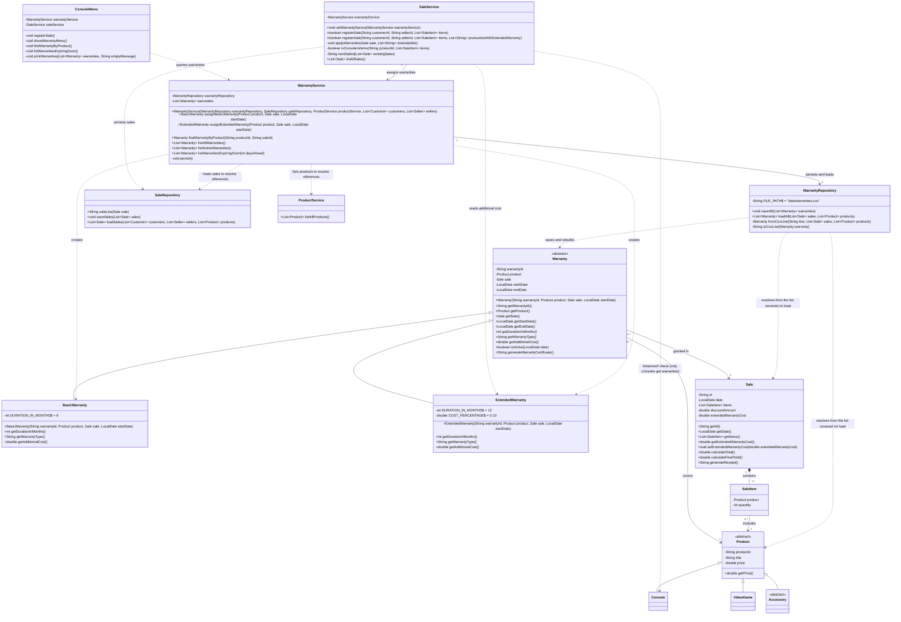

# Warranty Module - Class Diagram

Updated class diagram showing the new warranty hierarchy (`model`), the persistence and service classes of the module, and how the module is integrated with the existing system (`Sale`, `Product`, `Console`, `SaleService`, `ConsoleMenu`).

## Notes

- **Inheritance and polymorphism:** `Warranty` holds everything common (id, product, sale, dates, `isActive`, certificate). The three abstract methods are the only things each subclass has to provide, so no duration or cost logic is duplicated.
- **Integration with the sales flow:** `SaleService.registerSale` creates the sale, applies the promotion, and then calls `applyWarranties`, which uses `instanceof Console` to decide who gets a free `BasicWarranty` and sums the cost of every requested `ExtendedWarranty` into `Sale.extendedWarrantyCost`.
- **Dependencies of the persistence layer:** `WarrantyRepository` no longer depends on any service. It stores only the product and sale identifiers, and when loading it resolves them against the lists of sales and products that its caller passes to `loadAll`.
- **Where references are resolved:** `WarrantyService` receives `WarrantyRepository`, `SaleRepository` and `ProductService` through its constructor, plus the customers and sellers that `SaleRepository.loadSales` needs. It gathers the products (`ProductService.listAllProducts`) and the sales (`SaleRepository.loadSales`) and hands both lists to `WarrantyRepository.loadAll`.
- **Dependency between `SaleService` and `WarrantyService`:** `WarrantyService` no longer depends on `SaleService`, so there is no circular dependency between them. `WarrantyService` can therefore be created before `SaleService` in `Main`; `SaleService` keeps receiving it through `setWarrantyService`.
- **Persistence:** the end date is not stored in `warranties.csv`; it is recalculated by the `Warranty` constructor when the file is loaded. The discriminator column is `BASIC` or `EXTENDED`.